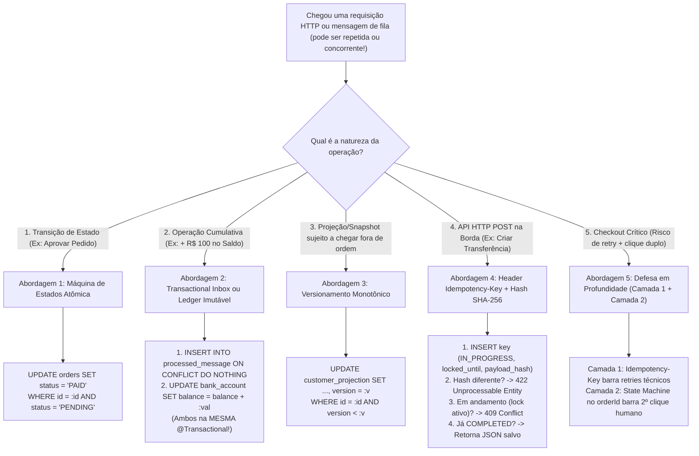
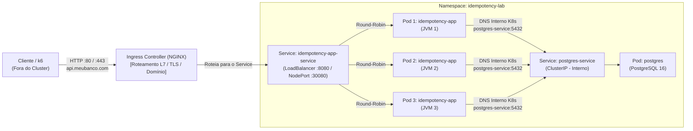

# Laboratório Prático de System Design: Idempotência, Concorrência & Sistemas Distribuídos

Este projeto é um **laboratório prático executável** em **Java 21 + Spring Boot + PostgreSQL + k6 + Kubernetes** desenhado para provar, na prática e sob fogo real de concorrência, **como bugs financeiros e de estoque acontecem em sistemas distribuídos** e **como cada padrão de Idempotência os resolve de forma atômica**.

---

## Sumário

1. [O Problema Fundamental & A Fórmula de Ouro](#1-o-problema-fundamental--a-fórmula-de-ouro)
2. [Árvore de Decisão: Qual Tratativa de Idempotência Escolher?](#2-árvore-de-decisão-qual-tratativa-de-idempotência-escolher)
3. [Ensinamentos e Opções de Tratativa (Os 6 Cenários Práticos)](#3-ensinamentos-e-opções-de-tratativa-os-6-cenários-práticos)
   - [Cenário 1: Operações Cumulativas (Depósito) — Naive vs. Race Condition vs. Transactional Inbox](#cenário-1-operações-cumulativas-depósito--naive-vs-race-condition-vs-transactional-inbox)
   - [Cenário 2: Máquina de Estados Atômica (`PENDING -> PAID`)](#cenário-2-máquina-de-estados-atômica-pending---paid)
   - [Cenário 3: Mensagens Fora de Ordem & Versionamento Monotônico (`WHERE version < :v`)](#cenário-3-mensagens-fora-de-ordem--versionamento-monotônico-where-version--v)
   - [Cenário 4: API HTTP Síncrona com `Idempotency-Key` (Padrão Stripe / IETF)](#cenário-4-api-http-síncrona-com-idempotency-key-padrão-stripe--ietf)
   - [Cenário 5: Defesa em Profundidade (Camada Técnica + Camada de Negócio)](#cenário-5-defesa-em-profundidade-camada-técnica--camada-de-negócio)
   - [Cenário 6: Ledger Contábil Imutável & Recuperação de Lease (`locked_until`)](#cenário-6-ledger-contábil-imutável--recuperação-de-lease-locked_until)
4. [Como Subir o Sistema (Local, Debug, Docker Compose)](#4-como-subir-o-sistema-local-debug-docker-compose)
5. [Como Testar Concorrência com o k6 (Scripts + Web Dashboard)](#5-como-testar-concorrência-com-o-k6-scripts--web-dashboard)
6. [Arquitetura e Configuração no Kubernetes (`k8s/`)](#6-arquitetura-e-configuração-no-kubernetes-k8s)

---

## 1. O Problema Fundamental & A Fórmula de Ouro

Em qualquer sistema distribuído (APIs HTTP, microsserviços, Kafka, RabbitMQ, SQS), **a rede não é confiável**. Quando um cliente ou mensageria envia um comando e sofre um *timeout* de rede antes de receber a confirmação (`ACK` ou `HTTP 200`), ele **não tem como saber** se o servidor caiu antes de processar ou depois de salvar no banco.

Por isso, todo sistema resiliente opera sob entrega **At-Least-Once (Pelo Menos Uma Vez)**: o cliente ou broker **vai reenviar a mensagem**.

> **A Fórmula de Ouro da Confiabilidade:**
> `Entrega At-Least-Once (Rede/Broker)` **+** `Consumidor Idempotente (Banco/App)` **=** `Processamento Effectively-Once`

Uma operação é **idempotente** quando aplicá-la **1 vez** ou **100 vezes** (em série ou em paralelo!) produz **exatamente o mesmo estado final no banco de dados** e **não dispara efeitos colaterais duplicados**.

---

## 2. Árvore de Decisão: Qual Tratativa de Idempotência Escolher?



### Tabela Comparativa das Tratativas

| Abordagem | Quando Usar | Mecanismo no Banco de Dados | Protege contra Concorrência (Race Condition)? | Protege contra Fora de Ordem? |
|---|---|---|---|---|
| **1. Natural / State Machine** | Mudar status (`PENDING -> PAID`), atribuir valor fixo | `UPDATE ... WHERE id = :id AND status = 'PENDING'` | ✅ Sim (Row-level lock nativo do `UPDATE`) | ⚠️ Apenas se o grafo de estados não tiver ciclos |
| **2. Transactional Inbox (`processed_message`)** | Incrementos (`saldo + 100`), envio de e-mail/eventos | `INSERT INTO processed_message ... ON CONFLICT DO NOTHING` + `UPDATE` na mesma transação | ✅ Sim (Unique Constraint do banco serializa) | ❌ Não (olha apenas se o `message_id` já veio) |
| **3. Versionamento Monotônico** | Sincronização de cadastro (`CustomerUpdated v1, v2, v3`) | `UPDATE ... SET version = :v WHERE id = :id AND version < :v` | ✅ Sim | ✅ **Sim** (descarta `v2` se já estiver na `v3`) |
| **4. HTTP `Idempotency-Key` + Lease** | Endpoints REST `POST` / `PATCH` expostos a clientes/gateways | Tabela `idempotency_key` com `request_hash`, `status`, `response_body` e `locked_until` | ✅ Sim (retorna `409 Conflict` durante execução concorrente) | N/A |
| **5. Defesa em Profundidade** | Fluxos financeiros críticos (Checkout, Pagamentos) | Combina **Abordagem 4** (borda HTTP) + **Abordagem 1 ou 2** (domínio) | ✅ Sim (em todas as camadas) | ✅ Sim |
| **6. Ledger Contábil Imutável** | Carteiras digitais, movimentação de estoque, extrato bancário | `INSERT INTO stock_movement (movement_id, delta) ON CONFLICT DO NOTHING` | ✅ Sim + **Trilha de Auditoria Completa** | ✅ Sim (soma algébrica comutativa) |

---

## 3. Ensinamentos e Opções de Tratativa (Os 6 Cenários Práticos)

O código-fonte está organizado em **6 Controllers independentes** em [`src/main/java/com/leonardonogueira/idempotency/api/`](./src/main/java/com/leonardonogueira/idempotency/api/), onde cada um expõe o **jeito errado (`❌ /api/wrong/...`)** e o **jeito certo (`✅ /api/fixed/...`)**.

---

### Cenário 1: Operações Cumulativas (Depósito) — Naive vs. Race Condition vs. Transactional Inbox

- **Arquivos:**
  - Controller: [`Scenario1DepositInboxController.java`](./src/main/java/com/leonardonogueira/idempotency/api/Scenario1DepositInboxController.java)
  - Consumidor Quebrado: [`BrokenDepositConsumer.java`](./src/main/java/com/leonardonogueira/idempotency/consumers/BrokenDepositConsumer.java)
  - Consumidor Corrigido: [`Approach2InboxConsumer.java`](./src/main/java/com/leonardonogueira/idempotency/consumers/Approach2InboxConsumer.java)
  - Script k6: [`k6/01-deposit-race-vs-inbox.js`](./k6/01-deposit-race-vs-inbox.js)

#### ❌ Erro 1: Sem Idempotência (`/api/wrong/deposits/naive`)
Operações cumulativas (`balance = balance + 100`) **nunca são naturalmente idempotentes**. Se o broker reentregar a mensagem `DepositMade(R$ 100)` 20 vezes, a conta recebe **`R$ 2.000,00`**.

#### ❌ Erro 2: A Armadilha Clássica do `Check-Then-Act` (`/api/wrong/deposits/race-condition`)
Muitos desenvolvedores tentam resolver fazendo um `SELECT` antes do `UPDATE`:
```java
// ❌ ERRADO: Sofre Race Condition sob concorrência!
if (processedRepo.existsById(id)) {
    return false;
}
bankAccountRepo.addToBalance(accountId, amount);
processedRepo.save(new ProcessedMessageEntity(id));
```
**Por que falha?** No isolamento padrão do PostgreSQL (`READ COMMITTED`), quando 20 threads chegam no mesmo milissegundo, **todas as 20 executam o `SELECT existsById` antes que a primeira faça o `COMMIT`**. Todas veem `false`, todas somam `R$ 100,00` no saldo, e o cliente ganha dinheiro duplicado!

#### ❌ Erro 3: Engolir Exceção no `try/catch` após gravar na Inbox
Se você insere o `message_id` na tabela `processed_message`, o código de negócio lança uma exceção logo abaixo, e você faz um `catch (Exception e) { log.error(...); }` **sem relançar a exceção**, o Spring faz o **commit da transação**! Resultado: a mensagem fica marcada como "processada" na tabela Inbox, o saldo **não** foi creditado, e qualquer reentrega futura será ignorada para sempre (**perda silenciosa de dinheiro**).

#### ✅ A Solução: Transactional Inbox (`/api/fixed/deposits/inbox`)
Invertemos a ordem: **primeiro tentamos inserir o `message_id` usando conflito atômico no banco**, dentro da **mesma `@Transactional`** da mudança de saldo:
```sql
INSERT INTO processed_message (message_id, consumer_name, processed_at)
VALUES (:messageId, :consumerName, CURRENT_TIMESTAMP)
ON CONFLICT (message_id, consumer_name) DO NOTHING;
```
- Se o `INSERT` retornar **`1` linha afetada**: ganhamos a corrida! Somamos o saldo na mesma transação.
- Se retornar **`0` linhas afetadas**: já foi processada (ou outra thread já ganhou). Descartamos imediatamente (`NO-OP`).
- Se der erro no meio da lógica de negócio: a exceção faz **rollback tanto do saldo quanto do `INSERT` na `processed_message`**, permitindo que a próxima tentativa do broker reprocesse com sucesso!

---

### Cenário 2: Máquina de Estados Atômica (`PENDING -> PAID`)

- **Arquivos:**
  - Controller: [`Scenario2OrderStateMachineController.java`](./src/main/java/com/leonardonogueira/idempotency/api/Scenario2OrderStateMachineController.java)
  - Consumidor: [`Approach1NaturalConsumer.java`](./src/main/java/com/leonardonogueira/idempotency/consumers/Approach1NaturalConsumer.java)
  - Repository: [`OrderRepository.java`](./src/main/java/com/leonardonogueira/idempotency/domain/OrderRepository.java)
  - Script k6: [`k6/02-order-state-machine.js`](./k6/02-order-state-machine.js)

#### ❌ O Problema
Receber o evento `PaymentApproved` 30 vezes simultâneas e disparar 30 notas fiscais e 30 pacotes na transportadora porque o código apenas fazia `order.setStatus("PAID"); repo.save(order);`.

#### ✅ A Solução: Condição de Guarda Atômica no `UPDATE` (`/api/fixed/orders/payment-approved`)
Não precisamos nem de tabela `processed_message` quando a própria entidade possui uma **Máquina de Estados unidirecional**:
```sql
UPDATE orders
SET status = 'PAID'
WHERE id = :orderId AND status = 'PENDING';
```
- O próprio PostgreSQL aplica um **Row-Level Lock (`FOR NO KEY UPDATE`)** na linha do pedido.
- Das 30 threads simultâneas, a **1ª thread** encontra `status = 'PENDING'`, muda para `'PAID'` e recebe `rowsUpdated == 1` (disparando o envio do pacote **uma única vez**).
- As outras **29 threads** aguardam o lock de microsegundos liberar, releem a linha já como `'PAID'`, não batem na cláusula `WHERE status = 'PENDING'` e recebem `rowsUpdated == 0`.

---

### Cenário 3: Mensagens Fora de Ordem & Versionamento Monotônico (`WHERE version < :v`)

- **Arquivos:**
  - Controller: [`Scenario3CustomerVersioningController.java`](./src/main/java/com/leonardonogueira/idempotency/api/Scenario3CustomerVersioningController.java)
  - Consumidor: [`Approach3VersionedConsumer.java`](./src/main/java/com/leonardonogueira/idempotency/consumers/Approach3VersionedConsumer.java)
  - Script k6: [`k6/03-customer-out-of-order-versioning.js`](./k6/03-customer-out-of-order-versioning.js)

#### ❌ O Problema: Mensagens Atrasadas (Out-of-Order Delivery)
O cliente atualiza seu cadastro 3 vezes:
1. `v1`: Nome = `"Leonardo v1"`, Email = `"v1@email.com"`
2. `v2`: Nome = `"Leonardo v2 (Antigo)"`, Email = `"v2@email.com"` *(sofre atraso na rede!)*
3. `v3`: Nome = `"Leonardo v3 (Mais Recente)"`, Email = `"v3@email.com"`

Se os eventos chegarem na ordem **`v1 -> v3 -> v2 (atrasado)`**, um `UPSERT` comum (`ON CONFLICT DO UPDATE` sem checar versão) ou até mesmo uma tabela `processed_message` (já que o `messageId` da `v2` é inédito!) vai **sobrescrever os dados da `v3` com os dados velhos da `v2`**!

#### ✅ A Solução: Versionamento Monotônico (`/api/fixed/customers/versioned`)
Cada evento carrega um número de versão crescente (`version`) gerado na origem. No consumidor, aplicamos:
```sql
UPDATE customer_projection
SET name = :name, email = :email, version = :version
WHERE id = :id AND version < :version;
```
- Quando `v1` chega -> aplica (`version` vai para `1`).
- Quando `v3` chega -> `1 < 3` é verdadeiro -> aplica (`version` vai para `3`).
- Quando `v2` atrasada chega -> `3 < 2` é **falso** -> `0` linhas afetadas! O dado antigo é ignorado com segurança.
- Quando `v3` duplicada chega -> `3 < 3` é **falso** -> `0` linhas afetadas! Resolve **duplicatas e fora de ordem** de uma só vez.

---

### Cenário 4: API HTTP Síncrona com `Idempotency-Key` (Padrão Stripe / IETF)

- **Arquivos:**
  - Controller: [`Scenario4HttpIdempotencyKeyController.java`](./src/main/java/com/leonardonogueira/idempotency/api/Scenario4HttpIdempotencyKeyController.java)
  - Serviço: [`HttpIdempotencyService.java`](./src/main/java/com/leonardonogueira/idempotency/httpkey/HttpIdempotencyService.java)
  - Script k6: [`k6/04-http-idempotency-key.js`](./k6/04-http-idempotency-key.js)

#### ✅ Como funciona o Ciclo de Vida Completo da `Idempotency-Key`
Quando o cliente chama `POST /api/fixed/transfers` enviando o header `Idempotency-Key: <UUID>`, o [`HttpIdempotencyService`](./src/main/java/com/leonardonogueira/idempotency/httpkey/HttpIdempotencyService.java) executa:

1. **Cálculo de Fingerprint (SHA-256):** Calcula o hash SHA-256 do body da requisição (`fromAccount`, `toAccount`, `amount`).
2. **Reserva Atômica (`IN_PROGRESS`):** Tenta inserir a chave na tabela `idempotency_key` com `status = 'IN_PROGRESS'` e um lease `locked_until = NOW() + 5s`.
3. **Se a chave já existir no banco:**
   - **Payload diferente do original (`request_hash` diverge):** Retorna **`422 Unprocessable Entity`** imediatamente (impede que o cliente reutilize a mesma chave para fazer uma transferência de outro valor).
   - **Ainda está `IN_PROGRESS` (outra thread está processando agora):** Retorna **`409 Conflict`** pedindo para o cliente aguardar e tentar novamente.
   - **Já está `COMPLETED`:** Retorna o **exato mesmo HTTP Status (`201 Created`) e o mesmo JSON (`transferId`)** que foram salvos na 1ª execução, sem tocar no saldo bancário novamente!

---

### Cenário 5: Defesa em Profundidade (Camada Técnica + Camada de Negócio)

- **Arquivos:**
  - Controller: [`Scenario5DefenseInDepthController.java`](./src/main/java/com/leonardonogueira/idempotency/api/Scenario5DefenseInDepthController.java)
  - Script k6: [`k6/05-defense-in-depth-checkout.js`](./k6/05-defense-in-depth-checkout.js)

#### Por que uma única camada não basta em sistemas financeiros?
Imagine o fluxo de Checkout de um pedido (`orderId = 500`):
- **Ameaça 1 (Rede / Mobile Gateway):** O app mobile envia `POST /checkout` com `Idempotency-Key: key-A`, sofre oscilação de 4G e reenvia com a mesma `Idempotency-Key: key-A`.
- **Ameaça 2 (Clique Duplo Humano / Bug de Frontend):** O usuário fecha a aba ou clica novamente no botão "Pagar", e o frontend **gera um novo UUID (`Idempotency-Key: key-B`)** para pagar o **mesmo `orderId = 500`**!

Se você tiver **apenas** a `Idempotency-Key`, a `key-B` passará livremente como se fosse uma requisição inédita e cobrará o cartão duas vezes!

#### ✅ A Solução: Defesa em Profundidade (`/api/fixed/checkout/defense-in-depth`)
Combinamos duas barreiras independentes:
1. **Camada 1 (Idempotência Técnica na Borda HTTP):** Verifica a `Idempotency-Key`. Se for retry técnico (`key-A`), devolve o recibo cacheado (`charged: true`) sem nem abrir transação de negócio.
2. **Camada 2 (Idempotência de Negócio no Domínio):** Dentro da execução da `key-B`, tenta fazer a transição atômica `UPDATE orders SET status = 'PAID' WHERE id = 500 AND status = 'PENDING'`. Como a `key-A` já mudou o pedido `500` para `'PAID'`, o banco retorna `0` linhas afetadas e a segunda cobrança é bloqueada (`ALREADY_PAID`, `charged: false`)!

---

### Cenário 6: Ledger Contábil Imutável & Recuperação de Lease (`locked_until`)

- **Arquivos:**
  - Controller: [`Scenario6ImmutableLedgerController.java`](./src/main/java/com/leonardonogueira/idempotency/api/Scenario6ImmutableLedgerController.java)
  - Repositório do Ledger: [`StockMovementRepository.java`](./src/main/java/com/leonardonogueira/idempotency/domain/StockMovementRepository.java)
  - Script k6: [`k6/06-immutable-ledger-and-lease.js`](./k6/06-immutable-ledger-and-lease.js)

#### Parte A: Razão Contábil Imutável (Immutable Ledger)
Em vez de fazer `UPDATE product SET stock = stock - 5` (que destrói o histórico de como você chegou naquele número) junto com uma tabela `processed_message` separada, sistemas bancários e de logística usam um **Ledger Imutável (`Append-Only`)**:
```sql
INSERT INTO stock_movement (movement_id, sku, delta, reason)
VALUES (:movementId, :sku, :delta, :reason)
ON CONFLICT (movement_id) DO NOTHING;
```
- **Por que é brilhante?** A própria linha do extrato contábil tem `UNIQUE (movement_id)`. A deduplicação, a alteração do saldo (`SUM(delta)`) e a trilha de auditoria acontecem em **um único `INSERT` atômico**!

#### Parte B: Recuperação de Chave Órfã (`IN_PROGRESS` Lease Expiration)
O que acontece se um Pod do Kubernetes reservar uma `Idempotency-Key` como `IN_PROGRESS` e **sofrer um `OOMKilled` ou queda de energia antes de mudar para `COMPLETED`**?
Sem um mecanismo de *Lease (aluguel com tempo de expiração)*, aquela chave ficaria travada em `IN_PROGRESS` (retornando `409 Conflict`) para sempre!

Em [`IdempotencyKeyRepository.java`](./src/main/java/com/leonardonogueira/idempotency/httpkey/IdempotencyKeyRepository.java), implementamos o **Lease Takeover Atômico**:
```sql
UPDATE idempotency_key
SET locked_until = :newLockedUntil, created_at = CURRENT_TIMESTAMP
WHERE idempotency_key = :key
  AND status = 'IN_PROGRESS'
  AND locked_until < :now;
```
Quando o cliente faz retry após o timeout do lease (`locked_until < NOW()`), o novo Pod assume a chave de forma atômica e conclui a operação com segurança!

---

## 4. Como Subir o Sistema (Local, Debug, Docker Compose)

Todos os comandos abaixo devem ser executados a partir da pasta [`idempotency/`](./) (onde ficam o `pom.xml`, `docker-compose.yml`, `k6/` e `k8s/`).

### Opção 1: Modo Rápido Local (Zero Configuração — H2 em Modo PostgreSQL)
Não precisa de Docker! O projeto sobe com banco em memória configurado com `MODE=PostgreSQL` (suportando `ON CONFLICT DO NOTHING` nativamente).

```powershell
# 1. Rodar a suíte automatizada com 8 testes de concorrência (JUnit 5 + CountDownLatch):
.\mvnw.cmd test

# 2. Subir a API na porta 8080:
.\mvnw.cmd spring-boot:run
```

> **Dica de Debug na IDE:** Abra a classe [`IdempotencyApplication.java`](./src/main/java/com/leonardonogueira/idempotency/IdempotencyApplication.java), coloque seus *breakpoints* nos Controllers ou Consumidores e pressione **`Shift + F9`** (atalho padrão IntelliJ) ou **`F5`** para depurar passo a passo.

### Opção 2: Com Docker Compose (PostgreSQL 16 Real + Kafka KRaft)
Se quiser rodar apontando para um container PostgreSQL 16 dedicado:

```powershell
# 1. Sobe o PostgreSQL 16 e o Kafka em background
docker compose up -d

# 2. Sobe a aplicação Spring Boot usando o profile "postgres"
.\mvnw.cmd spring-boot:run "-Dspring-boot.run.profiles=postgres"
```

---

## 5. Como Testar Concorrência com o k6 (Scripts + Web Dashboard)

Os 6 scripts na pasta [`k6/`](./k6/) disparam tempestades reais de Virtual Users (VUs) simultâneos contra a API e validam automaticamente (via `thresholds` e `teardown`) se o banco de dados manteve a consistência.

### Executando cada um dos 6 Cenários

Com a aplicação rodando em `http://localhost:8080`, execute:

```powershell
# Cenário 1: 20 VUs simultâneos testando Depósito (Naive vs Race Condition vs Transactional Inbox)
k6 run k6/01-deposit-race-vs-inbox.js

# Cenário 2: 30 VUs simultâneos tentando aprovar o mesmo pedido (State Machine PENDING -> PAID)
k6 run k6/02-order-state-machine.js

# Cenário 3: Eventos chegando fora de ordem (v1 -> v3 -> v2 atrasado -> v3 duplicado)
k6 run k6/03-customer-out-of-order-versioning.js

# Cenário 4: Ciclo completo da Idempotency-Key HTTP (201 Created, Replay idêntico, 422 Payload diferente, 20 VUs)
k6 run k6/04-http-idempotency-key.js

# Cenário 5: Defesa em Profundidade no Checkout (Retry técnico + Clique Duplo humano com nova chave)
k6 run k6/05-defense-in-depth-checkout.js

# Cenário 6: 25 VUs no Ledger Imutável de Estoque + Recuperação de Lease Expirado (IN_PROGRESS órfão)
k6 run k6/06-immutable-ledger-and-lease.js
```

### Visualizando o Relatório Gráfico do k6 (Web Dashboard)

O k6 possui um **Web Dashboard nativo** para visualizar gráficos de RPS, latência (`p95`, `p99`), VUs e contadores customizados (`inbox_applied_times`, `race_condition_passed_times`):

```powershell
# 1. Gerar um Relatório HTML interativo autocontido ao final do teste:
k6 run --out web-dashboard=export=relatorio-cenario1.html k6/01-deposit-race-vs-inbox.js
Invoke-Item .\relatorio-cenario1.html

# 2. Acompanhar o Dashboard AO VIVO no navegador em http://127.0.0.1:5665 durante o teste:
$env:K6_WEB_DASHBOARD="true"; $env:K6_WEB_DASHBOARD_OPEN="true"; k6 run k6/01-deposit-race-vs-inbox.js
```

---

## 6. Arquitetura e Configuração no Kubernetes (`k8s/`)

Para provar que nossas abordagens de Idempotência **não dependem de memória local da JVM (`synchronized` ou `ConcurrentHashMap`)** e funcionam perfeitamente em um **cluster distribuído com múltiplas réplicas**, o projeto inclui manifestos Kubernetes completos na pasta [`k8s/`](./k8s/).

### Topologia do Cluster Kubernetes (E Onde Entra o Ingress)



> **Qual a diferença entre `Service` e `Ingress`?**
> - **`Service` (`ClusterIP` / `LoadBalancer`):** Opera na camada de rede/transporte (L4 - TCP/IP). Ele dá um IP estável e um nome DNS interno para um grupo de Pods e distribui conexões entre eles. Em nuvem (AWS/GCP), cada `Service` do tipo `LoadBalancer` provisiona um balanceador pago (ELB/NLB).
> - **`Ingress` + `Ingress Controller` (ex.: NGINX, Traefik, AWS ALB):** Opera na camada de aplicação (L7 - HTTP/HTTPS). Permite que **um único ponto de entrada (1 IP público)** receba todo o tráfego HTTPS, termine o certificado SSL/TLS e roteie por **domínio (`host`)** ou **caminho (`path`, ex: `/pagamentos`, `/pedidos`)** para dezenas de `Services` internos (`ClusterIP`).

---

### Explicação Detalhada dos Manifestos (`k8s/`)

#### 1. [`k8s/01-namespace.yaml`](./k8s/01-namespace.yaml) — Isolamento Lógico
Cria o namespace `idempotency-lab`. Todos os recursos do projeto ficam isolados dentro dele, facilitando a visualização e permitindo remover ou pausar tudo sem afetar outros projetos do seu cluster.

#### 2. [`k8s/02-postgres.yaml`](./k8s/02-postgres.yaml) — Banco de Dados + DNS Interno (`ClusterIP`)
Contém dois objetos:
- **`Deployment` (`postgres`):** Sobe 1 Pod rodando `postgres:16-alpine` com uma `readinessProbe` que executa `pg_isready -U postgres -d idempotency_db` a cada 5 segundos. O Kubernetes só libera tráfego para o banco quando ele realmente está pronto para aceitar conexões SQL.
- **`Service` (`postgres-service` com `type: ClusterIP`):** Cria um endereço DNS interno exclusivo dentro do cluster (`postgres-service:5432`). Ele **não** fica exposto para fora do Kubernetes por segurança, mas qualquer Pod do Spring Boot consegue acessá-lo via `jdbc:postgresql://postgres-service:5432/idempotency_db`.

#### 3. [`k8s/03-app-deployment.yaml`](./k8s/03-app-deployment.yaml) — 3 Réplicas Distribuídas + `LoadBalancer`
Contém dois objetos fundamentais:
- **`Deployment` (`idempotency-app`):**
  - `replicas: 3`: Instrui o Kubernetes a manter **3 Pods (3 JVMs separadas)** rodando simultaneamente.
  - `imagePullPolicy: IfNotPresent`: Usa a imagem `idempotency-lab:latest` que construímos localmente no Docker Desktop sem tentar baixá-la do Docker Hub.
  - `readinessProbe` vs `livenessProbe`:
    - **`readinessProbe` (`initialDelaySeconds: 10`):** Pergunta *"A porta 8080 do Spring Boot já subiu?"*. Enquanto não subir, o Service **não envia requisições do k6 para este Pod** (evitando erros `502/Connection Refused` durante o deploy).
    - **`livenessProbe` (`initialDelaySeconds: 20`):** Pergunta *"O Pod travou?"*. Se parar de responder, o Kubernetes mata o Pod defeituoso e cria um novo automaticamente (*Self-Healing*).
  - `resources` (`requests` vs `limits`): Reserva `256Mi` de RAM / `0.25 CPU` garantidos por Pod e estabelece teto máximo de `512Mi` / `1 CPU`.
- **`Service` (`idempotency-app-service` com `type: LoadBalancer`):** Expõe a aplicação para a sua máquina Windows na porta `8080` (e `NodePort: 30080`), distribuindo as requisições do k6 entre os 3 Pods!

---

### Passo a Passo: Como Subir, Testar, Monitorar e Pausar o Cluster Kubernetes

Certifique-se de que a opção **Kubernetes -> Enable Kubernetes** esteja marcada nas configurações do seu **Docker Desktop**.

#### 1. Construir a Imagem e Subir os Pods no Kubernetes
Dentro da pasta `idempotency/`:

```powershell
# 1. Constrói a imagem Docker da aplicação Spring Boot (Multi-stage build com Java 21)
docker build -t idempotency-lab:latest .

# 2. Cria o Namespace e sobe o PostgreSQL 16
kubectl apply -f k8s/01-namespace.yaml
kubectl apply -f k8s/02-postgres.yaml

# 3. Aguarda o Pod do PostgreSQL ficar Ready (pronto para conexões SQL)
kubectl wait --namespace idempotency-lab --for=condition=ready pod -l app=postgres --timeout=90s

# 4. Sobe as 3 Réplicas (Pods) do Spring Boot e aguarda o rollout completar
kubectl apply -f k8s/03-app-deployment.yaml
kubectl rollout status deployment/idempotency-app -n idempotency-lab --timeout=120s

# 5. Confere os 4 Pods (3 da App + 1 do Postgres) e os Services rodando:
kubectl get pods,svc -n idempotency-lab
```

#### 2. Rodar o k6 contra o LoadBalancer do Kubernetes (3 Pods)
Quando o `idempotency-app-service` está no ar, ele escuta em `http://localhost:8080` (via LoadBalancer do Docker Desktop) e também em `http://localhost:30080` (via NodePort).

```powershell
k6 run -e BASE_URL=http://localhost:30080 --out web-dashboard=export=relatorio-k8s.html k6/01-deposit-race-vs-inbox.js
```

#### 3. Monitorar o Cluster Visualmente (`k9s` e `OpenLens`)
- **No Terminal com `k9s`:**
  ```powershell
  k9s -n idempotency-lab
  ```
  *(Dica: use as setas para selecionar um Pod e aperte **`l`** para ver os logs em tempo real, **`s`** para abrir um shell dentro do container, ou **`:svc`** para ver os Services).*
- **Na Interface Gráfica com `OpenLens`:**
  Abra o **OpenLens**, clique no ícone do cluster **`docker-desktop`**, vá em **Workloads -> Pods** e selecione o namespace **`idempotency-lab`** no filtro do topo.

#### 4. Como "Descer" (Pausar) o Projeto no Kubernetes sem Deletar a Configuração
Para zerar o consumo de RAM e CPU das aplicações quando pausar os estudos, **sem apagar** os seus `Deployments` e `Services`:

```powershell
# Desliga todos os Pods (escala para 0 réplicas, liberando 100% da memória das JVMs e do Postgres):
kubectl scale deployment idempotency-app --replicas=0 -n idempotency-lab
kubectl scale deployment postgres --replicas=0 -n idempotency-lab
```

Quando quiser retomar os estudos, basta religar os Pods em segundos:

```powershell
# Religa o banco e as 3 réplicas da aplicação:
kubectl scale deployment postgres --replicas=1 -n idempotency-lab
kubectl scale deployment idempotency-app --replicas=3 -n idempotency-lab
```
